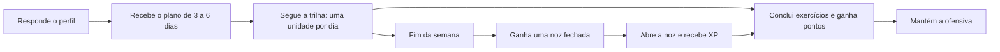
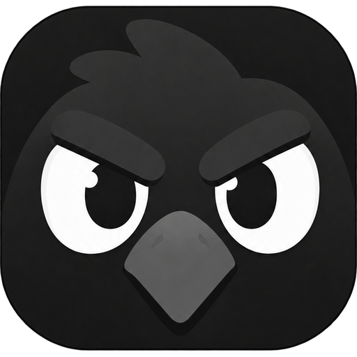
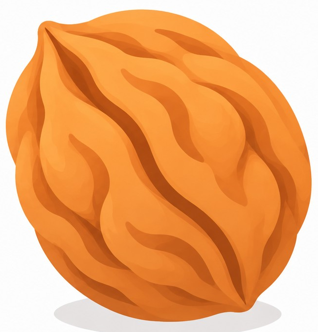
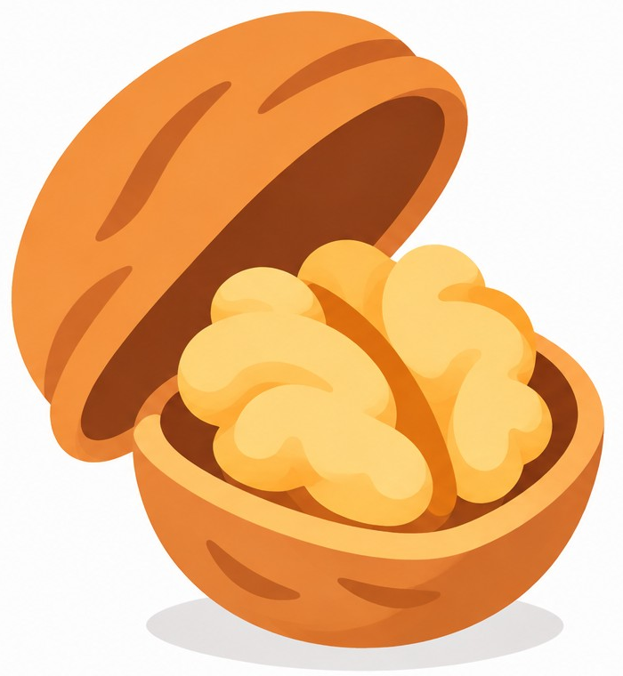
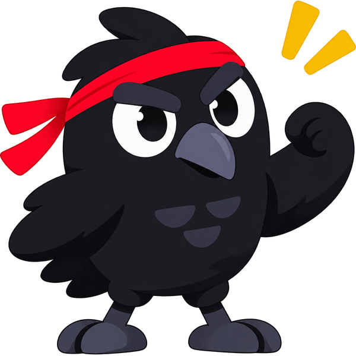

<div align="center">


# Treino sem equipamento, um dia de cada vez

**Uma semana de treinos montada para você, uma trilha para seguir, uma ofensiva para não quebrar e nozes de recompensa no fim de cada semana.**

[**Abrir o app**](https://virusdosol.github.io/crowfit/) · [Direção visual](#-direção-visual) · [Como funciona](#-como-funciona) · [Instalar](#-instalar-no-celular) · [Seus dados](#-seus-dados)


</div>

---

## 🧭 Em uma frase

Você responde algumas perguntas, o Crowfit monta a sua semana, e o corvo te acompanha enquanto você constrói a ofensiva.

<div align="center">


</div>

---

## 🎨 Direção visual

O Crowfit é **branco, vermelho, preto e laranja**, com cara de app de hábitos: limpo, direto e com um toque de energia.

### Paleta

| Papel | Cor | Hex | Onde aparece |
|---|---|---|---|
| Fundo |  | `#FFFFFF` | Todas as telas |
| Cartões |  | `#F8F8FB` | Cartões e painéis |
| Texto |  | `#17171C` | Títulos, texto, o corvo |
| Destaque |  | `#E3182D` | Ofensiva, botões, dias ativos |
| Vermelho escuro |  | `#B8121F` | Estados pressionados |
| Dourado |  | `#F5B800` | Brilho e detalhes |
| Laranja da chama |  | `#FF9F00` | Chama e nozes |
| Linhas |  | `#E6E6EE` | Bordas e divisórias |
| Texto secundário |  | `#5E5E73` | Legendas e dicas |

**Regra de ouro:** vermelho é o único destaque. Se algo está em vermelho, é importante: a ofensiva, um dia ativo, um botão principal.

### Tipografia

- **Fredoka**: números grandes e títulos de destaque (o contador de ofensiva, o XP da noz).
- **Nunito**: textos, botões e legendas.

### Formas e espaçamento

- Cartões com **borda de 2px** em `#E6E6EE` e **cantos de 18 a 24px**.
- Margem lateral de **18px** e largura máxima de **480px**, pensada primeiro para o celular.
- Dias de calendário com **pílulas**: sequências ativas viram faixas contínuas vermelhas.

### Ícones e imagens: o que é fixo

| Elemento | Regra |
|---|---|
| Logotipo | Versão **preta** (`logo-dark.png`) em fundos claros; a branca (`logo.png`) é só para fundos escuros. |
| Chama da ofensiva | PNG original (`flame.png`), sem redesenho e sem substituição por ícone genérico. |
| Nozes | Recortes da referência (`noz-fechada.png` e `noz-aberta.png`). |
| Corvo | `mascot.png`, sempre com o logotipo original. |
| Símbolos dos dias | Planetas da astrologia clássica, um por dia (veja abaixo). |

### Os símbolos dos dias

Cada dia da semana tem um astro, e cada astro representa um grupo de treino. A semana começa no **domingo**.

| Dia | Símbolo | Astro | Grupo |
|---|---|---|---|
| Domingo | ☉ | Sol | Ombros |
| Segunda | ☽ | Lua | Peito |
| Terça | ♂ | Marte | Braços |
| Quarta | ☿ | Mercúrio | Abdômen |
| Quinta | ♃ | Júpiter | Pernas |
| Sexta | ♀ | Vênus | Costas |
| Sábado | ♄ | Saturno | **Descanso** |

O descanso é sempre no **sábado** e aparece na trilha com um anel tracejado e o rótulo "descanso".

---

## 🧩 Como funciona

Um ciclo simples, do primeiro acesso à noz:



### 1. Seu plano

No primeiro acesso, o app pergunta nome, idade, peso, altura, experiência e quantos dias por semana você quer treinar (3, 4, 5 ou 6). Os treinos são montados com base nisso, com dias de descanso já distribuídos.

<div align="center">



</div>

### 2. A trilha

A tela inicial é uma trilha de **unidades, uma por dia**, agrupadas em **semanas de 7 dias** (de domingo a sábado). Cada semana muda a cor dos círculos.

- Cada unidade abre **no dia dela**. Não dá para adiantar treinos.
- Unidades de dias anteriores continuam disponíveis para concluir.
- Só o mês atual (4 semanas) fica liberado. Os meses seguintes aparecem com cadeado.
- O treino guiado mostra um exercício por vez, com cronômetro para exercícios por tempo e descanso entre as séries.

### 3. A ofensiva

A ofensiva conta **dias seguidos treinados**. Ela tem uma chama com pena e um calendário com faixas vermelhas.

<div align="center">


</div>

- O dia registrado é o **da própria unidade**: concluir hoje a unidade de ontem registra ontem.
- Dias de descanso **não quebram** a ofensiva.
- Perder um dia de treino previsto zera a contagem atual. A **melhor ofensiva** nunca diminui.
- No calendário, a faixa vermelha une os dias seguidos, a bolinha azul marca hoje (quando ainda não treinou) e o contorno preto marca o dia selecionado.

> **Pendente:** a trilha usa o **sábado** como descanso, mas a regra de ofensiva ainda considera o **domingo** como descanso. Assim, um sábado sem treino pode quebrar a ofensiva mesmo sendo dia de descanso na trilha. Essa regra ainda será ajustada.

### 4. As nozes

No fim de cada semana (de domingo a sábado) você ganha **uma noz fechada**.

- Ao tocar nela, uma tela mostra a noz aberta e um **número aleatório de XP**, proporcional ao seu nível.
- Cada noz só pode ser aberta uma vez, e o XP fica salvo na sua conta.
- As nozes ficam na tela de **Ofensivas**, abaixo do calendário.

<div align="center">

&nbsp;&nbsp;&nbsp;&nbsp;➜&nbsp;&nbsp;&nbsp;&nbsp;

</div>

### 5. Pontos e níveis

| Ação | Pontos |
|---|---|
| Exercício concluído | +10 |
| Unidade concluída (bônus) | +20 |
| Noz aberta | aleatório, de 20 a 50 vezes o nível atual |

- Um nível novo a cada **200 pontos**, com barra de progresso.
- Cada recompensa é concedida **uma única vez**. Refazer uma unidade não repete pontos.

---

## 📲 Instalar no celular

1. Abra **https://virusdosol.github.io/crowfit/** no **Chrome** (Android) ou no **Safari** (iPhone).
2. Toque em **Instalar app** (Chrome) ou em **Compartilhar > Adicionar à Tela de Início** (Safari).
3. Abra pelo ícone novo. O primeiro acesso e o primeiro login precisam de internet; depois, o app abre offline neste aparelho.

---

## 💾 Seus dados

O progresso fica **primeiro no seu aparelho**, separado por conta:

| Chave | Conteúdo |
|---|---|
| `corvofit-v2:u:<UID>` | Progresso da conta: perfil de treino, pontos, nozes, recompensas, ofensiva, dias concluídos, histórico, plano e trilha. O `<UID>` é o identificador da conta no Supabase; o e-mail nunca é usado como chave. |
| `corvofit-v2:sync:<UID>` | Metadados de sincronização. Pode ser apagada sem perder progresso: o app só reenvia. |
| `corvofit-v1` | Chave **histórica** de antes das contas. Nunca é apagada nem reescrita. |

- Sair da conta **não apaga** nada. Outra conta vê outra partição.
- Se a gravação falhar (por exemplo, armazenamento cheio), o app mostra o aviso **"Alterações NÃO salvas"**.
- Se os dados estiverem corrompidos, o app **não os apaga**: mostra uma tela de recuperação e guarda uma cópia.
- Limpar os dados do navegador ou desinstalar o app **apaga o progresso deste aparelho**.
- **Exportar backup** e **Importar backup** (arquivo `.json`) ficam em *Perfil > Dados e backup*. A importação valida o arquivo e guarda uma cópia dos dados atuais antes de trocar.

---

## 🔐 Conta e login

- Cadastro e login por e-mail e senha, login com Google, recuperação e troca de senha, e logout (Supabase Auth). A sessão fica salva no navegador.
- Sem sessão, uma tela de acesso cobre o app. Sem internet, o app abre na partição da última conta, se ela já tiver entrado neste aparelho.
- **Perfil remoto:** o nome de exibição fica em `public.profiles`, com leitura e atualização por RLS. O perfil de treino (idade, peso, altura) **não** vai ao servidor.
- O **SDK do Supabase** é carregado de `cdn.jsdelivr.net` (versão fixada) e guardado em cache pelo service worker.
- A chave publicável em `supabase-config.js` é pública por design. Nunca coloque ali `service_role`, senhas ou o Client Secret do Google.

---

## 🔄 Sincronização

> **Status:** implementada e coberta por uma suíte automatizada (`node --test`) que usa um servidor simulado com as mesmas regras do SQL. **Não foi validada em produção:** falta o teste manual em dois aparelhos contra o Supabase real (veja `RELATORIO_AUDITORIA.md`).

### O que é sincronizado

| Dado | Tabela no Supabase | Como o conflito é resolvido |
|---|---|---|
| Pontos (base + recompensas), melhor ofensiva, última data de treino, dias concluídos, histórico de planos, recompensas | `user_progress` | Pontos: a base mais alta vence e as recompensas são uma união. Datas e dias: união. Melhor ofensiva e última data: o maior valor. Nada regride. |
| Sessões de treino do histórico | `workout_sessions` | Sessão finalizada é imutável; só o feedback pode ser preenchido, uma vez. |
| Início da trilha | `trail_state.start` | Só é gravado uma vez. Um aparelho sem nenhuma marca local aceita o início da conta. |
| Níveis congelados por seção | `trail_state.levels` | Já gravado prevalece; seções novas são adicionadas. |
| Exercícios marcados e desmarcados (cada unidade × exercício) | `trail_exercise_states` | O último a mudar vence (`changed_at`). Desmarcar é um estado como outro, então a desmarcação sincroniza. Empate: "desmarcado" vence. |
| Experiência, dias por semana, ajuste de dificuldade e sequência de feedback fácil | `training_settings` | O último a mudar vence, pelo horário da mudança. Um perfil local que nunca sincronizou prevalece sobre a conta. |
| Nozes abertas (semana e XP) | `user_nozes` | Uma noz por semana. Repetição não concede XP de novo. O XP já entra nos pontos pelo progresso. |
| Conquistas desbloqueadas | `achievements_unlocked` | Envio pronto, mas o app ainda não tem conquistas. |

A leitura é feita por `SELECT` com RLS: cada usuário só vê as próprias linhas. Toda escrita passa por funções `SECURITY DEFINER` que usam `auth.uid()`; o app nunca envia um UID.

### O que permanece somente local

- **Idade, peso e altura.** Nunca são enviados ao servidor. Um aparelho novo pede esses dados no onboarding.
- **Nome do perfil** (`S.profile.nome`) não vai para `training_settings`. O nome de exibição vai para `public.profiles`, pelo caminho que já existia.
- **Metadados de sincronização** (`corvofit-v2:sync:<UID>`): assinaturas, horários de mudança e o cache do que já foi enviado. Podem ser apagados sem perder progresso; o app reenvia.
- **Treino em andamento** (`S.active`).
- **Ajustes de interface** e o que está no cache offline.

### Quando sincroniza

Ao entrar na conta, ao salvar (agrupado por ~4 s), ao voltar a conexão, ao voltar para o app (puxa mudanças de outros aparelhos mesmo sem mudança local) e em novas tentativas após falha de rede.

### Offline e erros

- O app abre e funciona sem rede. Tudo continua salvo localmente.
- Sem rede, a pendência é registrada e o envio é repetido quando a conexão volta, com intervalos de 15 s, 60 s e 5 min.
- Se o servidor recusar um conteúdo (erro de validação), o app não repete sozinho o mesmo conteúdo, mantém tudo local e avisa.
- Se as tabelas v2 ainda não existirem no banco, a parte nova é ignorada e o progresso continua sincronizando.
- Cada rodada pertence a uma conta e a uma "geração" do app: se a conta trocar no meio de uma resposta, nada é gravado na conta errada.

### Limites conhecidos

- A hora de cada mudança de exercício é a hora em que o app percebe a mudança durante a sincronização, não o toque exato.
- O aplicativo ainda sorteia o XP da noz no próprio aparelho. A função `open_my_noz` do servidor existe, mas o app não a chama.
- O estado de sincronização da trilha fica no navegador e pode passar de 100 KB.
- O servidor confia no XP enviado por `merge_my_nozes` (importação de nozes antigas). Não há conferência de fórmula.

## 🛠 Para quem quer mexer no código

HTML, CSS e JavaScript puro, sem build e sem framework. Dependências externas: SDK do Supabase (CDN, versão fixada) e as fontes Fredoka e Nunito (Google Fonts, só visual).

```
crowfit/
├── index.html              # telas, estilo e lógica principal (inclui a tela de Ofensivas e as nozes)
├── core.js                 # regras puras: validação, pontos, ofensiva, nozes, sessões, recompensas
├── store.js                # armazenamento local por conta
├── program.js              # programação dos treinos, grupos e símbolos dos dias
├── trail.js                # trilha: semanas, unidades, pontos e ofensiva por unidade
├── trail.css               # estilo da trilha (inclui o destaque do descanso)
├── supabase-config.js      # URL e chave publicável do Supabase
├── auth.js, auth-ui.js     # autenticação e telas de entrada
├── auth.css                # estilo das telas de autenticação
├── profile.js              # painel de perfil e perfil remoto
├── profile.css, settings.css
├── supabase-sync.js        # sincronização (RPCs, fila, offline, reconciliação)
├── sw.js                   # service worker (cache offline)
├── manifest.json           # PWA
├── supabase-profiles*.sql, supabase-sync.sql
├── supabase-sync-v2.sql    # migração v2: trilha, exercícios, configurações e nozes (depois da v1)
├── tests/                  # testes automatizados da sincronização (node --test; o app não usa)
└── imagens: logo.png, logo-dark.png, mascot.png, flame.png, noz-aberta.png,
             noz-fechada.png, intro-logo.png, intro-mascot.png, splash.jpg, icon-*.png
```

Ordem de carregamento no `index.html`: SDK, `supabase-config.js`, `auth.js`, `auth-ui.js`, `profile.js`, `core.js`, `store.js`, `program.js`, `trail.js`, `supabase-sync.js` e, por fim, o script do app.

**Rodar localmente:** sirva a pasta com um servidor estático (por exemplo `python3 -m http.server`) e abra `http://localhost:8000`. O service worker só funciona em `localhost` ou `https`.

**Atualizando o app:** depois de mudar um arquivo, aumente `CACHE_VERSION` no `sw.js` e inclua os arquivos novos na lista de cache. O service worker usa a rede primeiro para HTML, JS e JSON, apaga só caches com o prefixo `crowfit-cache-` e **nunca intercepta nem guarda** requisições ao Supabase.

---

## ☁️ Instalação própria (seu projeto Supabase)

O login e a sincronização só funcionam com o **seu** projeto Supabase.

1. Crie o projeto e coloque a URL e a chave publicável em `supabase-config.js`.
2. No *SQL Editor*, execute em um banco novo, nesta ordem: `supabase-profiles.sql`, `supabase-sync.sql` e depois `supabase-sync-v2.sql`. Use `supabase-profiles-verify.sql` para conferir os perfis. (O projeto original já tem esses scripts aplicados.)
3. Em *Authentication > URL Configuration*, defina o Site URL com o endereço real do app e as Redirect URLs (com e sem `index.html`; `http://localhost:PORTA/**` para testes locais).
4. Em *Authentication > Providers*, ative e-mail (decida sobre "Confirm email") e Google (Client ID e Secret só no painel do Supabase).
5. No Google Cloud, autorize o URI `https://<seu-projeto>.supabase.co/auth/v1/callback`.
6. Para publicar: fork, *Settings > Pages*, branch `main`, pasta `/ (root)`.

O SMTP padrão do Supabase tem limite baixo de envios; para uso real, configure um SMTP próprio.

---

## 🗺 Ainda não tem

- Abertura de noz pelo servidor (`open_my_noz`) no app.
- Perfil de treino (idade, peso, altura) na nuvem: continua somente local, por decisão.
- Conquistas (o envio já existe; faltam o catálogo e os desbloqueios).
- Tela de histórico de sessões.
- Ilustrações ou vídeos dos exercícios.
- Ligas, amigos e lembretes diários.
- Ajuste da regra de descanso da ofensiva para o sábado (a trilha usa sábado; a ofensiva ainda conta domingo).

Sugestões e contribuições são bem-vindas: abra uma *issue* ou um *pull request*.

---

## ⚠️ Observações

- O Crowfit não substitui orientação médica nem de um profissional de educação física. Se você tem alguma condição de saúde, converse com um profissional antes de começar.
- Respeite o seu corpo: se algo doer, pare ou pule o exercício.

---

<div align="center">



Feito por **virusdosol** para quem quer treinar em qualquer lugar, sem desculpa e sem equipamento.

</div>
